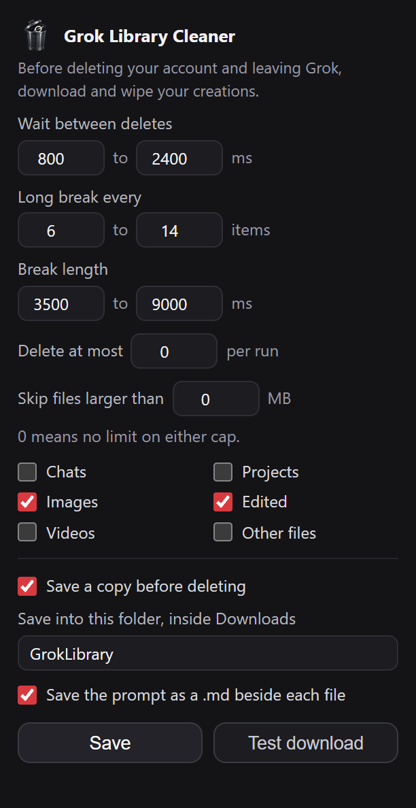

<p align="center">
  
</p>

<h1 align="center">Grok Library Cleaner</h1>

<p align="center">Before deleting your account and leaving Grok, download and wipe your creations.</p>

<p align="center">
  
  
  
  <a href="LICENSE"></a>
</p>

Grok keeps every image and video it generates, and clearing them on `grok.com/library` means a hover menu and a confirmation dialog for each one. This extension works the library in both directions. Turn on saving and it writes each asset to disk with the prompt that made it, then deletes at a human pace: one tile at a time, or as a single confirmed sweep with a progress bar, a stop button and a size guard.

Chats and projects are two more removal types in the same popup, both off by default, swept with the same scan, confirm and pacing.

That order is the point. You leave with your work instead of a folder of untitled renders, and the library gets empty without you clicking a menu fifteen thousand times.

<p align="center">
  
</p>

<p align="center"><sub>The settings popup at its real size, with saving turned on and a page cap set.</sub></p>

## Install

```bash
git clone https://github.com/apoapostolov/grok-library-cleaner.git
```

1. Open `chrome://extensions` and switch on **Developer mode**.
2. Choose **Load unpacked** and select the cloned folder.
3. Reload any open `grok.com/library` tab.

Chrome loads unpacked extensions from a folder, never from an archive, so the same build is also packaged in [`dist/`](dist): download the zip, unzip it anywhere, and point **Load unpacked** at the unzipped folder. It holds the files Chrome needs, without the readme, the changelog or the icon sources.

## What you get

**Chats and projects.** Two removal types beyond the library, off by default. Chats are the sessions in the sidebar. Projects are what Grok stores as workspaces, and they are deleted through the same confirmed sweep. Neither has a size or a download step, because neither is a file. A chat that belongs to a project is left alone when you remove chats, so clearing sessions cannot gut a project. With a per-run cap set, the queue fills in the order the popup shows: chats, then projects, then library files.

**Save first.** With **Save a copy before deleting** on, every asset is written to disk before its delete request is sent, and a matching `.md` holds the prompt plus model, mode, aspect ratio and dimensions. A file that fails to save is never deleted, so a bad path or a full disk cannot cost you an image.

**Per-item delete.** A 26px trash glyph in the top-right corner of every tile. One click removes that asset. No menu, no dialog, and a toast in the bottom-right confirms which file went.

**Delete all from the popup.** The same button also lives in the settings popup, above Save, so you never have to be on the library page. It finds an open Grok tab and starts the run there; if none is open it opens the library first. The scan, the confirm and the progress bar all live in the tab, so the run keeps its toast and its Stop button where you can see them. If a run is already going in that tab, the popup says so instead of starting a second one.

**Delete all.** Two clicks to arm, then a scan of the whole library and a confirm toast showing the queue size and per-class breakdown. Nothing is deleted until you press **Delete N**. During the run the toast carries a live progress bar with the count, failures, elapsed time and ETA, plus a **Stop** button. Every run can be stopped between items.

**Page cap.** *Scan at most* sets how many pages of the list a run reads before it stops looking. A page holds 60 assets, so 20 pages is around 1,200 of them. Left at 0 the scan reads the whole list, as it always did, and the confirm toast says where a capped run stopped so a queue of 1,200 is never mistaken for the entire library.

**Stop when the rest is spent.** *Ask to stop after* counts pages with no candidates: no asset your type filters and size cap would queue. A page of videos with videos switched off counts, and so does a page of renders over the size limit, even though both pages are full of files. After that many in a row the scan pauses and asks whether stopping makes sense. **Yes** ends the scan there and takes you to the confirmation with what it found; **Proceed** walks on to the page cap or the end of the list. The question comes once per run, and at 0 it never comes at all.

**Separate selectors** for images (`image.jpg`), edited images (`edited-image.jpg`), videos (`generated_video.mp4`) and other files, with an optional per-run cap for a first pass on a large library.

**Size guard.** *Skip files over N MB* keeps big renders out of a bulk purge. `sizeBytes` ships with every list row, so the guard adds no requests and no scanning time. It applies while the queue is built, before anything is deleted, and the confirm toast reports how many matches were spared. On a sample of 600 recent assets, a 1 MB cap spared 1.4% of plain images and 100% of videos. The per-tile glyph still deletes whatever you click, cap or no cap, because that click is explicit.

## Keep a copy before it goes

Saving is off until you turn it on, and the folder field starts empty. Name a folder and copies land sorted by creation day, for example `Downloads/GrokLibrary/2026-10-21/`. Leave the field empty and the day folders sit straight in Downloads, at `Downloads/2026-10-21/`.

Files are named from the asset itself, so they read like a person filed them:

```
2026-10-18_2143-07_image_sunlit-portrait-unbuttoned-linen-shirt_7c41ba2e.jpg
2026-10-14_1912-55_edit_warmer-golden-hour-bare-shoulder_52d90f6b.jpg
2026-10-09_1136-42_video_slow-pan-summer-dress-in-the-breeze_9ab3e810.mp4
```

That is the creation timestamp in local time, the kind (image, edit, video, file), a slug of the prompt, and the first eight characters of the asset id so a duplicate can always be traced back.

**Prompts are saved too.** Grok keeps the generation input on each asset, so the extension reads it and writes a matching `.md` beside the file: the prompt in a fenced block, plus size, dimensions, creation time, model, mode, aspect ratio and a link back to the conversation. Assets that have no prompt, such as your own uploads, get no `.md`.

Naming and prompt lookup cost one extra `GET /rest/assets/<id>` per item. A save only counts as done when the file finished and its byte size matches what the API reported, so an error page posing as a download can never authorise a delete. If a save fails, that item stays in the library and is reported in the summary.

**Test download** in the popup writes a small text file to the chosen folder and reports the exact path, so you can confirm the path works before committing to a long run.

## Pacing

The library endpoints rate limit, and the limiter answers `429` with no `Retry-After` header, so the extension spaces its own work:

| Behaviour | Default |
| --- | --- |
| Gap between deletes | 800 to 2400 ms, randomized per item |
| Long break | every 6 to 14 items, 3.5 to 9 s |
| Cooldown on 429 | 18 to 32 s with jitter, then retry |
| Scan page gap | 1200 to 2000 ms, 60 assets per page |
| Failed request retries | 4 attempts, then counted and skipped |

All of it is adjustable in the toolbar popup.

## How it works

The extension drives the same REST endpoints the page uses, with your existing session cookies:

- `GET /rest/app-chat/conversations` lists chats 60 at a time by `pageToken`, each with the `workspaces[]` it belongs to.
- `DELETE /rest/app-chat/conversations/<id>` removes one chat.
- `GET /rest/workspaces?kind=WORKSPACE_KIND_ALL` lists projects.
- `DELETE /rest/workspaces/<id>` removes one project.
- `GET /rest/assets` lists the library, newest first, paginated by `pageToken`.
- `GET /rest/assets/<assetId>` returns one asset, including `mediaGenInput` with the prompt and generation settings.
- `DELETE /rest/assets-metadata/<assetId>` removes one asset.
- `https://assets.grok.com/<key>` serves the file itself. It answers `403` without your session cookies, so downloads go through Chrome's download manager rather than a fetch.

The page also fires `POST /rest/media/post/delete` before deleting a tile and that endpoint answers `404` for library assets, so it is a no-op worth ignoring.

Tiles are found by `button[data-library-item-id]`, which carries the asset id. A `MutationObserver` keeps the glyphs in place across infinite scroll and client-side re-renders.

The extension has no backend and no analytics. It talks to `grok.com` for the library and to `assets.grok.com` for the files, and needs the `downloads` permission for the copies.

## Notes

- The content script runs on every `grok.com` page, not just the library, because the popup can start a run from any Grok tab. On a page without a library grid it decorates nothing and adds no button.
- Deletion is permanent on Grok's side and there is no undo, for chats and projects as much as for images.
- Deleting a project removes the project. What Grok does with the chats inside it is Grok's behaviour, and the extension does not know in advance.
- Saving is opt in. Turn on **Save a copy before deleting**, click **Test download** once, open the folder, then start the purge.
- The prompt `.md` files are on by default once saving is on, and can be switched off on their own.
- Keep the library tab open while a run is in progress.
- Not affiliated with xAI or Grok.
